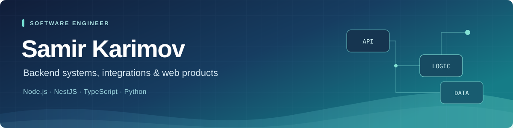

  

  <strong>Backend systems · Integrations & automation · End-to-end product development</strong>

  Software engineer with <strong>5+ years of commercial experience</strong>, based in Baku, Azerbaijan. 
  I build web products from requirements and architecture to implementation and deployment. 
  My main focus is <strong>Node.js, NestJS, TypeScript and Python</strong>.

> **A selection of my work:** many of my commercial projects cannot be shared publicly due to client agreements. This profile includes projects I can share and demonstration versions of selected client work. Each project is identified accordingly.

  
  &nbsp;
  

---

## 🧭 About me

- I design and implement backend services, APIs, database models and business workflows.
- I connect business systems and automate processes that otherwise require repetitive manual work.
- I work across the stack when a product needs it, from backend logic to its web interface and deployment.
- I have delivered projects as a sole developer and led a small development team while contributing to architecture and code.
- I am developing a manhua processing and reading platform for a client, connecting computer vision, translation data and a web reader.

## 🛠️ Tech stack

**Backend**

    

**Databases & storage**

   

**Frontend**

  

**Testing & delivery**

   

REST APIs · WebSockets · Task queues · Unit, integration and end-to-end testing

---

## 🚀 Selected projects

### MyBuild · Construction marketplace

**Client project · Public demonstration version**

A two-sided marketplace where clients publish construction jobs, companies submit offers, and both sides manage work stages and acceptance.

I led two developers, contributed to architecture and implementation, and handled technical communication with the client. The project includes order workflows, WebSocket updates and private files accessed through temporary links.

The original client project cannot be shared under the client agreement. The public repository is a separate demonstration version created to showcase the product's core workflows.

`NestJS` `Next.js` `TypeScript` `PostgreSQL` `Supabase`

[Explore the demonstration repository →](https://github.com/KarimovSamir/my-build)

### Manhua processing & reading platform

**Client project · Three connected engineering projects**

A platform commissioned by a client, connecting specialized text detection, page processing and a multilingual reader. The three parts address different stages of the same workflow:

**1. Model training & synthetic data**

I developed and trained a YOLO OBB model for detecting text lines and vertical columns on Chinese comic pages, including rotated text and stylized lettering. My work covers data preparation, a synthetic example generator, automatic annotation and model training.

The generator uses **100,000+ cleaned background images**, a corpus of **500,000 text fragments** and **15 font families**. Labels are derived from rendered text masks, with geometry checks and source separation between training and validation/test splits.

`Python` `Ultralytics YOLO OBB` `Pillow` `NumPy` `Multiprocessing`

**2. Page processing pipeline**

Processes real manhua pages into text regions, structured JSON and images with the original text removed. The pipeline handles tall pages, region merging, coordinate mapping and inpainting, preparing the assets and layout data for OCR, translation and display in the reader.

`Python` `Computer vision` `Inpainting` `JSON`

**3. Web reader**

A reader with a bilingual English/Russian interface, bookmarks, ratings, comments and reading progress. Translations are overlaid on cleaned page images using coordinates from JSON, with text sizing and color adaptation. The architecture uses server rendering, locale-specific metadata, server-side API routes and caching.

`Next.js` `React` `JavaScript` `Supabase` `Cloudflare Workers` `R2` `KV`

### Business system integration · 1C & government HR portal

**Commercial work at SynApps.az**

Built a Python/Flask integration between 1C and a government HR portal. Automated hiring, termination, employee transfers and staffing operations with Selenium, eliminating duplicate manual data entry. Separate processes handled different companies and concurrent requests.

`Python` `Flask` `Selenium` `1C integration`

### SHP · Corporate website

**Client project**

Independently delivered a corporate website in three languages within three weeks, covering implementation and deployment.

`JavaScript` `HTML` `CSS` `Cloudinary` `Vercel`

---

## 💼 Experience

**Software Engineer / Full-stack Developer · My Digital Home**  
February 2024 — Present · Baku, Azerbaijan

Develop B2B web products from requirements and architecture through backend, frontend, databases, testing and deployment. Combine hands-on implementation with technical coordination and maintenance of existing client systems.

**Consultant / Developer · SynApps.az**  
June 2021 — November 2023 · Baku, Azerbaijan

Developed business integrations and process automation, investigated and resolved client issues, and helped new developers understand the project and complete their tasks.

## 🤝 Let's connect

Open to **Backend / Software Engineer roles** and **contract development projects**. Based in Baku; open to remote work and relocation.

[LinkedIn](https://www.linkedin.com/in/kerimovsam/) · [karimovsamir93@gmail.com](mailto:karimovsamir93@gmail.com)
